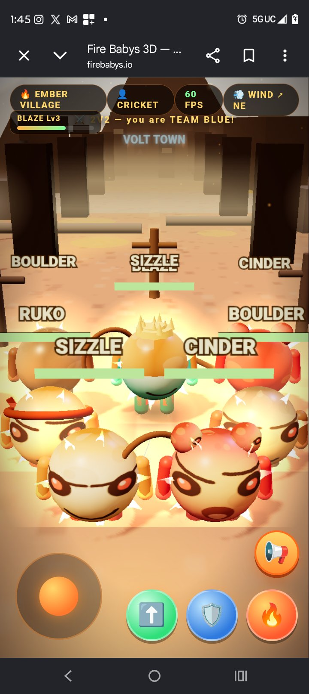

# Fire Babys Memories Archive

## 2026-10-03 — The frozen game (Jeff's phone)

Jeff's screenshot from his Android phone: the 3D game frozen in multiplayer 2v2 mode ("you are TEAM BLUE!") in Volt Town. Characters clumped together with duplicated name labels, 60 FPS but unresponsive. In Jeff's words: "the teams hard ship to keep the game running while I'm a new creator is hard." Saved for the "then and now" memories video.

## 2026-10-03 — Godot build memory captures begin
Jeff: "take memory picks and videos of the creation of the game for a memory video later on in life." New capture stream at `godot-build/` (CAPTURE-LOG.md): first Blaze screenshot + 3s clip from day one of the Godot 4 project.

## 2026-10-03 — First Godot character reveal
Built the first real Fire Baby character in Godot 4 to Jeff's IMAX 3D spec. Front + three-quarter stills and 5s performance clip rendered in-engine, saved to godot-build/ and posted to Discord #announcements.
